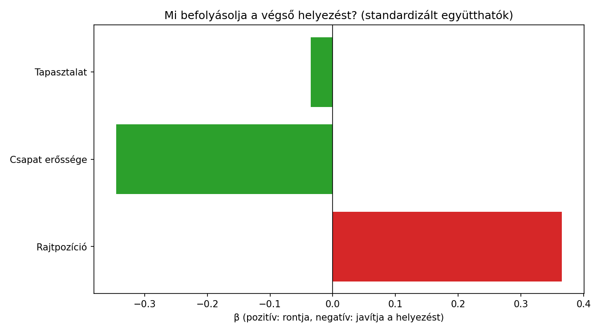
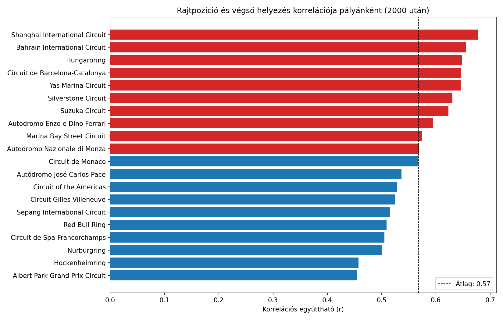
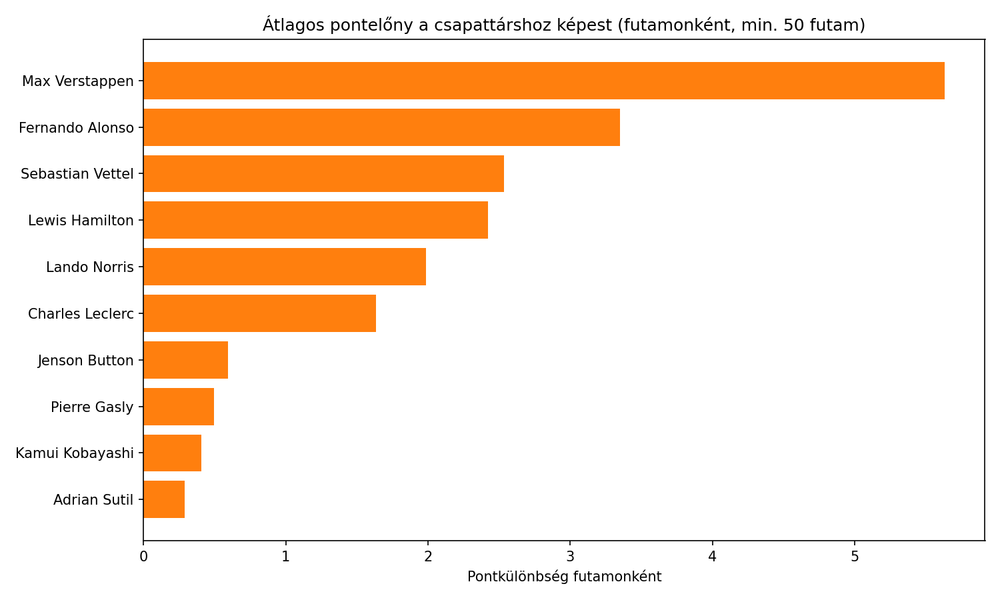
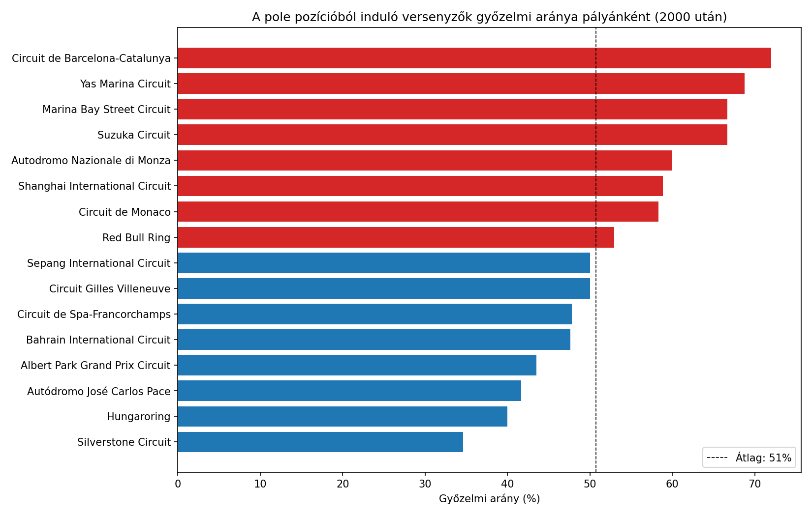
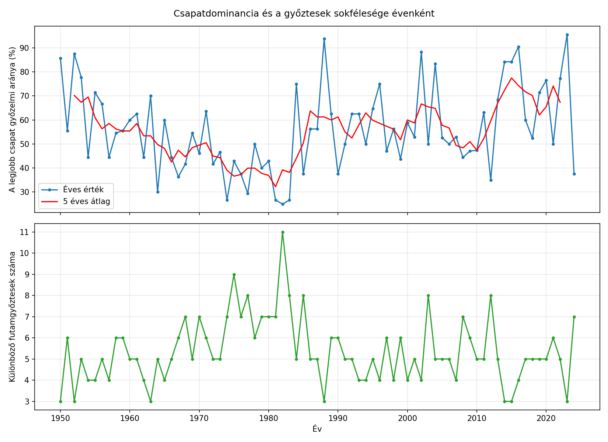

# Formula 1 elemzés

Python szorgalmi feladat: egy Kaggle adatcsomag elemzése öt szabadon választott kérdés alapján.

## Adatforrás

- **Adatcsomag:** [Formula 1 World Championship (1950-2020)](https://www.kaggle.com/datasets/rohanrao/formula-1-world-championship-1950-2020) (`rohanrao/formula-1-world-championship-1950-2020`)
- **Tartalom:** több CSV fájl a Formula 1 történetéről (versenyzők, csapatok, futamok, pályák, eredmények)
- **Használt fájlok:**
  - `results.csv`: futamonkénti eredmények (rajtpozíció, végső helyezés, pontok, csapat)
  - `drivers.csv`: versenyzők nevei
  - `races.csv`: futamok, évszámok, dátumok, pályák
  - `circuits.csv`: pályák nevei
  - `constructors.csv`: csapatok nevei
- A script a `kagglehub` csomaggal automatikusan letölti az adatot.

## Használt könyvtárak

| Könyvtár | Mire használom |
|----------|----------------|
| pandas | CSV beolvasás, `merge`, `groupby`, `transform`, új jellemzők számítása |
| numpy | lineáris regresszió (`np.linalg.lstsq`), korreláció (`np.corrcoef`), szóráselemzés |
| matplotlib | vízszintes oszlopdiagramok |
| kagglehub | adatcsomag letöltése a Kaggle-ről |

## Telepítés és futtatás

```bash
git clone https://github.com/hauberbenedek-collab/f1elemzes.git
cd f1elemzes
pip install -r requirements.txt
python elemzes.py
```

Ha a Kaggle letöltés nem működik, töltsd le kézzel az adatcsomagot, és tedd a CSV fájlokat az `f1_adatok` mappába (vagy a script mellé).

Az ábrák az `abrak/` mappába is mentésre kerülnek.

## Adatkezelés

- A hiányzó értékeket az adatban `\N` jelöli, ezt a beolvasáskor `na_values` paraméterrel kezelem.
- A `grid = 0` sorokat (bokszutcából rajtolók) kihagyom a rajtpozíciós elemzésekből.
- A 2010 utáni évekre szűkítem a regressziót és a csapatelemzést, mert 2010 óta egységes a pontozási rendszer.

## Az öt kérdés

### 1. Mi határozza meg a végső helyezést: a rajtpozíció, a csapat ereje vagy a versenyző tapasztalata?

Három magyarázó változóból többváltozós lineáris regressziót építek `np.linalg.lstsq` segítségével:

- **Rajtpozíció:** a `grid` oszlop
- **Csapat erőssége:** a csapat átlagos pontszáma az adott szezonban (`groupby` és `transform`)
- **Tapasztalat:** a versenyző korábbi futamainak száma (`cumcount`)

A változókat standardizálom, így az együtthatók összehasonlíthatók. A script kiírja az együtthatókat és az R² értéket, valamint azt, hogy a csapat erejének hozzáadása mennyit javít a csak rajtpozíciós modellen.

Egyszerűsítés: a csapat ereje a szezon összes futamából számolódik, így részben tartalmazza a vizsgált futam eredményét is.



### 2. Melyik pályán számít a legjobban a rajtpozíció?

2000 után, pályánként kiszámolom a rajtpozíció és a végső helyezés korrelációját (`np.corrcoef`), azokra a pályákra, ahol legalább kb. 10 futam adata van. A legerősebb és leggyengébb kapcsolatú pályák oszlopdiagramon látszanak.



### 3. Mennyit számít a csapat, és ki teljesít a legjobban a csapattársához képest?

- **Csapathatás:** szóráselemzéssel megmutatom, hogy a futamonkénti pontszerzés varianciájának hány százalékát magyarázza az, hogy melyik csapatban ül a versenyző az adott évben.
- **Csapattárs-összehasonlítás:** futamonként kiszámolom, hogy a versenyző hány ponttal szerez többet a csapattársa(i) átlagánál, majd versenyzőnként átlagolom (legalább 50 futam).



### 4. Hol nyer a legnagyobb eséllyel a pole pozícióból induló versenyző?

2000 után pályánként kiszámolom, hogy a pole-ból (`grid == 1`) induló versenyzők hány százaléka nyerte meg a futamot (legalább 15 futam pályánként). Ezt összevetem a 2. kérdés korrelációs mérőszámával (`np.corrcoef`), hogy a két módszer ugyanazt mutatja-e. A script a Monacót külön is kiírja.



### 5. Hogyan változott a csapatok dominanciája az évek során?

Szezononként kiszámolom, hogy a legsikeresebb csapat a futamok hány százalékát nyerte (`groupby`, `idxmax`), és hány különböző versenyző nyert futamot. Két panelen ábrázolom, 5 éves mozgóátlaggal, és numpy maszkolással évtizedes átlagokat számolok. Végül korrelációt számolok a két mutató között.



## Eredmények

_Futtatás után ide írd be a saját megállapításaidat mondatokban, a script kimenete alapján._

## Szerző

Hauber Benedek
